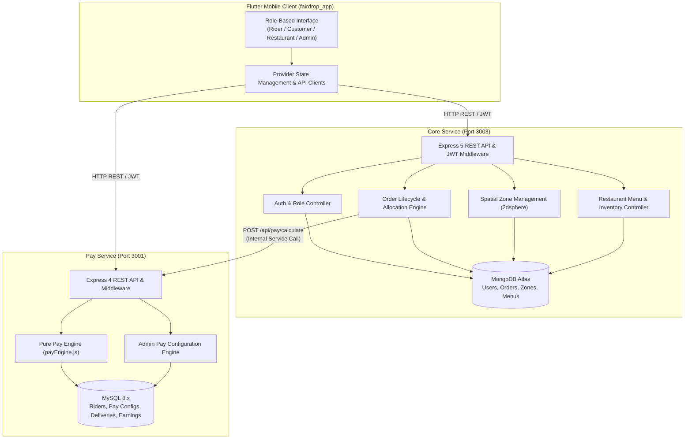

# FairDrop

Transparent Pay and Algorithmic Equity Engine for Last-Mile Food Delivery Workers

## Problem

Gig delivery platforms in India rely on opaque dynamic pay algorithms, arbitrary delay penalties, and threshold-based ("cliff") bonus targets that compel couriers into hazardous 10-to-12-hour workdays.
Couriers bear uncompensated restaurant waiting times, out-of-zone dispatches without return guarantees, and sub-minimum wage hourly returns with zero upfront financial transparency.
No major food delivery platform in India scored higher than six out of ten on the Fairwork India Ratings 2024 across the five foundational principles of platform work.
FairDrop establishes an operationally viable platform architecture that guarantees upfront formula visibility, spatial zone protections, linear incentives, and statutory wage floor compliance.

## Features by Role

- **Rider**:
  - Upfront formula transparency and guaranteed estimated payout displayed before accepting an order.
  - Line-by-line seven-item delivery ledger detailing base pay, distance earnings, surge bonus, wait compensation, and linear incentives.
  - Zero-penalty order decline without hidden algorithmic deprioritization or shadow-banning.
  - Out-of-zone dispatch notification requiring explicit consent, paired with automatic hub reassignment upon delivery.
  - Automatic restaurant wait-time tracking with statutory wait compensation credited upon delivery completion.
  - Statutory minimum wage floor compliance tracking evaluated over completed 60-minute blocks of engaged delivery time.
  - Shift dashboard and earnings analytics comparing linear incentives against traditional cliff-tier structures.
- **Customer**:
  - Spatial restaurant discovery filtered by active service zones.
  - Delivery pin selection with haversine distance calculation to merchant partners.
  - Clean billing structure where customer item subtotal equals total payable, with zero hidden platform, delivery, or surge markups.
  - Live inventory defense blocking out-of-stock or disabled dishes directly in the cart.
  - Seamless checkout flow with automated kitchen order dispatch and status tracking.
- **Restaurant**:
  - Menu catalog management with custom item pricing and food preparation durations.
  - Instant item availability toggling with backend-enforced rejection of unavailable items.
  - Kitchen display feed featuring live order status transitions and preparation countdown timers.
- **Admin**:
  - Inspection of active platform pay configurations and historical wage rate revisions.
  - Pay configuration updates governed by an enforced seven-day advance notice rule.
  - Audit logging of policy changes citing fair work compliance standards.

## Pay Formula

FairDrop calculates delivery compensation using a deterministic, transparent formula published to the courier prior to dispatch:

$$\text{Total Delivery Pay} = \text{Base Rate} + (\text{Distance (km)} \times \text{Per-Km Rate}) + \text{Surge Bonus} + \text{Wait Compensation} + \text{FairDrop Incentive}$$

- **Base Rate**: Fixed base compensation per completed delivery (baseline: INR 15.00).
- **Distance Pay**: Metered distance in kilometres multiplied by the active distance rate (baseline: INR 6.00/km).
- **Surge Bonus**: Flat incentive applied when surge conditions are active in the dispatch zone (baseline: INR 20.00).
- **Wait Compensation**: Flat compensation awarded when verified restaurant waiting time exceeds the configured threshold (baseline: INR 10.00).
- **FairDrop Incentive**: Linear per-order incentive replacing cliff bonuses (baseline: INR 17.04 per order, derived from standard 27-order ladder targets).
- **Statutory Wage Floor**: Minimum wage floor protection (baseline: INR 70.00/hr, benchmarked against Kerala minimum wage standards) evaluated across completed 60-minute blocks of cumulative engaged order time, with shortfalls topped up automatically.

All formula parameters are configurable by platform administrators via the administrative API.

## Architecture

The system operates as a monorepo consisting of two backend microservices communicating via authenticated HTTP and a unified Flutter mobile application:



For inter-service calculation specifications, refer to the [API Contract](docs/api-contract.md). For detailed product specifications, refer to the [Product Requirements Document](docs/FairDrop_Flutter_App_PRD_v2.1.md).

## Tech Stack

| Layer | Technology | Runtime / Port | Data Store / Storage | Responsibility |
|---|---|---|---|---|
| Core Service | Node.js, Express 5 | Port 3003 | MongoDB (GeoJSON 2dsphere) | Authentication, orders, spatial zone queries, restaurant menus |
| Pay Service | Node.js, Express 4 | Port 3001 | MySQL 8.x | Pure pay calculation, earnings ledger, 7-day notice pay configs |
| Mobile Client | Flutter, Dart | Android / Web | flutter_secure_storage, SharedPreferences | Multi-role user interface, Provider state, OpenStreetMap rendering |
| Spatial Engine | Mongoose 2dsphere, Turf/Haversine | Built-in | GeoJSON Polygons | Point-in-polygon assignment, distance metering, boundary checks |
| Test Runner | Node.js built-in test runner, Flutter test | CLI | In-memory / Isolated DB | Unit, integration, widget, and end-to-end smoke verification |

## Repo Structure

- `.env.example`: Template for monorepo root environment variables used by automation scripts.
- `.gitignore`: Git configuration specifying intentionally untracked build files and dependencies.
- `README.md`: Project summary, architecture, pay formulas, and developer instructions.
- `core-service/`: Node.js and Express service managing authentication, orders, restaurants, and spatial zones on Port 3003.
- `database/`: Database schema definitions, MySQL initialization scripts, and MongoDB collection structures.
- `docs/`: Product Requirements Document and inter-service API contract specifications.
- `fairdrop_app/`: Cross-platform Flutter application providing interfaces for riders, customers, restaurants, and administrators.
- `package.json`: Monorepo npm configuration defining unified build, test, seed, and smoke orchestration scripts.
- `package-lock.json`: Dependency lockfile pinning exact versions for root npm utilities.
- `pay-service/`: Node.js and Express service hosting the pure pay calculation engine and audit ledger on Port 3001.
- `scripts/`: Monorepo utility scripts including database seeding and automated 14-step smoke test execution.

## Setup and Run

### Prerequisites

- Node.js 18 LTS or higher
- MySQL Community Server 8.x
- MongoDB 6.x or MongoDB Atlas cluster
- Flutter SDK 3.13 or higher with Android platform tools

### 1. Environment Configuration

Copy the example environment files in both services and root:

```bash
cp .env.example .env
cp core-service/.env.example core-service/.env
cp pay-service/.env.example pay-service/.env
```

Configure credentials in each `.env` file using placeholder values:

- In `core-service/.env`:
  ```ini
  PORT=3003
  MONGODB_URI=mongodb://localhost:27017/fairdrop_core
  JWT_SECRET=your_jwt_secret_key_here
  JWT_EXPIRES_IN=24h
  PAY_SERVICE_URL=http://localhost:3001
  ```

- In `pay-service/.env`:
  ```ini
  PORT=3001
  DB_HOST=localhost
  DB_PORT=3306
  DB_USER=root
  DB_PASSWORD=your_mysql_password_here
  DB_NAME=fairdrop_pay
  JWT_SECRET=your_jwt_secret_key_here
  ```

### 2. Dependency Installation

Install dependencies across the monorepo:

```bash
npm install
cd core-service && npm install && cd ..
cd pay-service && npm install && cd ..
cd fairdrop_app && flutter pub get && cd ..
```

### 3. Database Initialization

Execute the master seed script to initialize MongoDB collections and MySQL schema with default zones, accounts, and baseline pay parameters:

```bash
npm run seed
```

### 4. Running Backend Services

Start both microservices in separate terminal sessions:

```bash
# Terminal 1: Pay Service
cd pay-service
npm start

# Terminal 2: Core Service
cd core-service
npm start
```

Verify service availability:

```bash
curl http://localhost:3001/api/health
curl http://localhost:3003/api/health
```

### 5. Running the Mobile Application

Launch the Flutter client:

```bash
cd fairdrop_app
flutter run
```

## Tests

Execute test suites across backend services, mobile client, and integration smoke pipelines:

- Core service integration tests:
  ```bash
  npm run test:core
  ```
- Pay service unit and calculation tests:
  ```bash
  npm run test:pay
  ```
- Flutter widget and unit tests:
  ```bash
  npm run test:flutter
  ```
- End-to-end 14-step automated HTTP smoke test:
  ```bash
  npm run smoke
  ```
- Full monorepo verification suite:
  ```bash
  npm run test:all
  ```

## Scope

### Implemented

- Pure, deterministic linear pay calculation engine with zero external arithmetic side effects.
- Line-by-line seven-item ledger with itemized breakdown per completed delivery.
- Upfront formula and estimated compensation disclosure on order dispatch.
- GeoJSON polygon spatial zone allocation and automatic zone boundary conflict detection using MongoDB 2dsphere indexing.
- Out-of-zone delivery detection, courier consent enforcement, and automatic hub reassignment.
- Restaurant wait-time recording with server-side validation and automated wait compensation.
- Statutory minimum wage floor protection evaluated over completed 60-minute blocks of engaged delivery time.
- Administrative pay configuration management enforcing a mandatory seven-day advance notice rule.
- Multi-role mobile client supporting Rider, Customer, Restaurant, and Admin user journeys.
- End-to-end automated 14-step HTTP integration smoke test suite.

### Deliberately Out of Scope

- Hardware GPS tracking and turn-by-turn road routing (straight-line haversine calculation used).
- Real payment gateway integration and actual banking disbursements (mock payment flow implemented).
- Live external road traffic and railway gate status APIs (modeled through verified delay flags).
- Multi-restaurant cart checkouts and customer-facing live driver location tracking.
- Production-scale clustering, container orchestration, and cloud infrastructure deployment.

## Team

- **Raihan**: Pay Service (Port 3001), MySQL schema and audit ledger, Delivery Summary, Rider Dashboard, Comparative Analytics, Admin Pay Config.
- **Harikrishnan**: Core Service (Port 3003), MongoDB schema and spatial indexing, Authentication and JWT, Order Lifecycle, Spatial Zone Allocation, Active Delivery Tracking.

Department of Master of Computer Applications, TKM College of Engineering, Kollam, Kerala.  
MCA Mini Project (Course Code: 23MCAM307).
